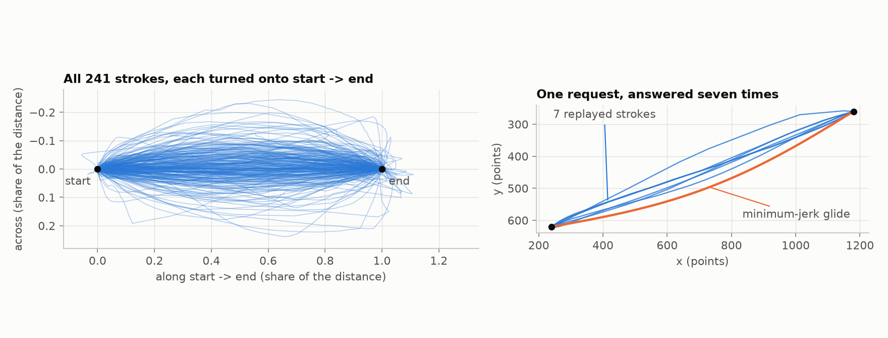
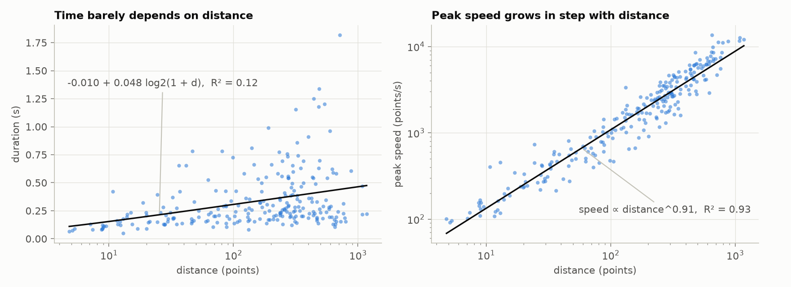
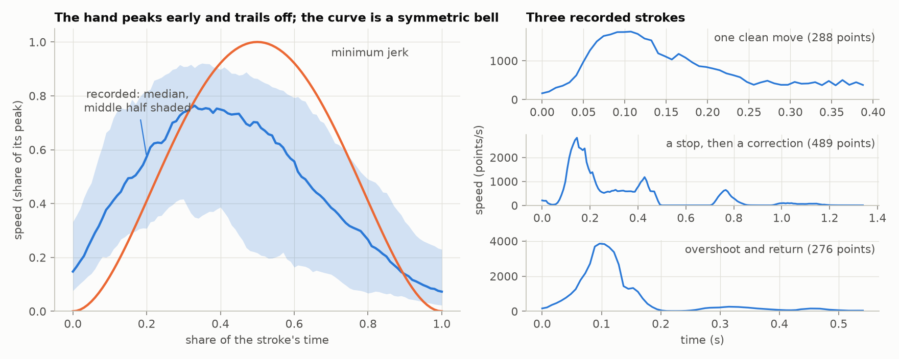
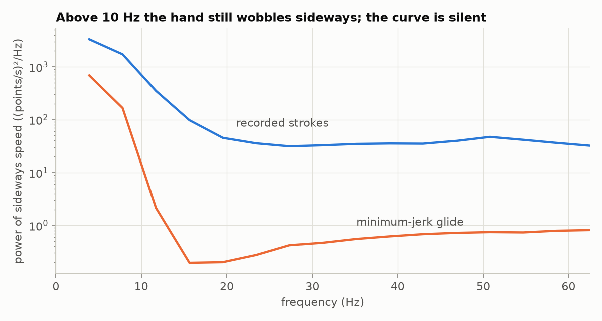
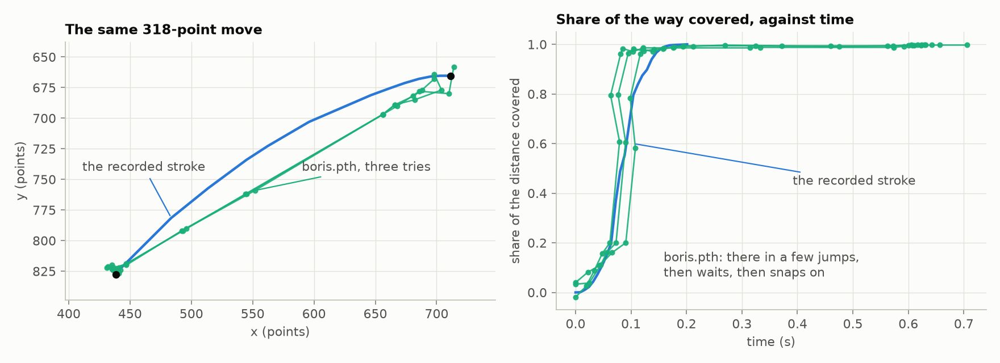

# Natural Pointer

Move the pointer the way a recorded human hand moved it.

Most "human" mouse movers draw a curve: a bezier, or a minimum-jerk glide with a
bow. A curve is smooth, symmetric and the same every time, and it looks it.
Natural Pointer does not draw. It keeps a library of strokes cut from a real
recording, and for each move it replays one of them, turned and scaled onto the
start and end you ask for. The timing, the tremor, the overshoot and the small
corrections are the hand's own.



## Use it

```bash
pip install "natural-pointer[control] @ git+https://github.com/longevityboris/natural-pointer"
```

Plan a path (standard library only, nothing moves):

```python
from natural_pointer import NaturalPointer, position_at

pointer = NaturalPointer()
path = pointer.path((100, 100), (900, 500), screen=(1800, 1169))
# [(0.0, 100.0, 100.0), (0.0083, 100.5, 99.7), ..., (0.301, 900.0, 500.0)]
#   seconds from the start, x, y

x, y = position_at(path, 0.12)     # where the pointer is 120 ms in
```

Move the real pointer (needs the `control` extra, which installs `pyautogui`):

```python
pointer.move_to(500, 300)
pointer.click(800, 400)
pointer.right_click(700, 200)
pointer.double_click(300, 500)
```

`NaturalPointer(method=...)` chooses how paths are made: `"stroke"` (default),
`"bezier"` (the fallback when the library cannot be read) or `"model"` (the
retired network, see below). `NaturalPointer(seed=7)` makes the choices
repeatable.

### From Swift

`swift/HumanStroke.swift` is one file with no dependencies beyond Foundation.
Add it to your target, ship `natural_pointer/data/strokes.json` beside your
app, and:

```swift
var hand = try HumanStrokeLibrary(contentsOf: strokesURL)        // once

let path = hand.path(from: cursor, to: target, screen: screenSize)   // CGPoint, CGPoint, CGSize
let began = CFAbsoluteTimeGetCurrent()
while true {
    let elapsed = CFAbsoluteTimeGetCurrent() - began
    let want = path.point(at: elapsed)        // steer the pointer towards this
    // ... send your relative move for (want - whereThePointerIsNow) ...
    if elapsed >= path.duration { break }
}
usleep(useconds_t(hand.dwell() * 1_000_000))  // rest as long as the hand did before a click
```

The path is a list of samples about 8 ms apart; `position(at:)` runs straight
between them, so it can be read at any rate. To slow every move down, read it
at `elapsed / 1.5`.

The Swift code is a port of the Python: the same library and seed give the
same path. To check:

```bash
swiftc -O swift/HumanStroke.swift swift/SelfTest/main.swift -o swift/.build/selftest
swift/.build/selftest natural_pointer/data/strokes.json swift/SelfTest/fixtures.json
# ok: 36 paths, 1090 points match Python (largest difference 0.0)
```

## How it works

1. **Cut.** A stroke runs from rest to rest. The recording is cut wherever the
   mouse sent no report for 100 ms, at every click, and around drags. A stop
   shorter than 450 ms followed by a small move (under 35% of the main move and
   under 60 points) is a correction and stays in its stroke, because landing on
   a target is one act. A run of moves with no clear stop is cut where the hand
   all but stops (under 40 points/s).
2. **Clean.** A stroke is kept if it is one aimed movement that will survive
   being pointed somewhere else: at least 4 points long, 0.04 to 3 s, clear of
   the screen edges, at least 0.75 as straight as its chord, never more than 8%
   behind its start, 30% past its end or 25% to the side.
3. **Store.** Each stroke is turned so that it starts at (0, 0) and ends on the
   +x axis. `strokes.json` holds 241 of them in 147 kB, as whole numbers
   (0.1 ms, 0.1 point).
4. **Replay.** For a request, every stroke is scored on how far its length and
   direction are from what is asked; one of the six best is picked at random,
   never one of the last four used. It is scaled and turned onto start -> end.
   Three small random changes keep two replays of one stroke from matching:
   pace (-7% to +9%), where in time the speed peaks, and bow (±15%). The first
   point is the start and the last is exactly the end.

## What the recording shows

`mouse_data.json` is 512 seconds of one person using a mouse on an 1800 × 1169
point screen: 11,788 move reports at 125 Hz, 83 clicks. It yields 297 strokes,
of which 241 pass cleaning. Reproduce every number here with
`python scripts/analyze.py` (results in `docs/stats.json`).

| | 10th percentile | median | 90th percentile |
|---|---|---|---|
| Distance (points) | 19 | 207 | 586 |
| Duration (s) | 0.13 | 0.24 | 0.65 |
| Peak speed (points/s) | 239 | 1,787 | 6,251 |
| When speed peaks (share of the stroke's time) | 0.13 | 0.39 | 0.68 |
| Straightness (chord / path length) | 0.89 | 0.98 | 1.00 |
| Bow (largest sideways drift / distance) | 0.02 | 0.05 | 0.13 |
| Sideways tremor (points, rms) | 0.08 | 0.25 | 0.93 |
| Rest on the target before a click (s) | 0.016 | 0.037 | 0.19 |
| Button held (s) | 0.087 | 0.112 | 0.151 |
| Rest between strokes (s) | 0.03 | 0.31 | 2.1 |

**Time barely depends on distance.** The textbook law (Fitts) says longer
moves take longer. Here the fit `duration = -0.010 + 0.048 · log2(1 + distance)`
explains 12% of the variance. What scales is speed: peak speed grows as
distance^0.91 (R² 0.93). A 600-point move and a 60-point move both take about
a quarter of a second; the long one is simply ten times faster. A glide whose
time grows with distance, as most do, is wrong for this hand.



**The speed curve is lopsided.** The hand reaches its peak speed 39% of the
way through and then trails off. A minimum-jerk curve peaks at exactly 50% and
is symmetric. One stroke in six has more than one burst of speed (31 have two,
11 have three), 27% contain a hesitation of 30 ms or more, and 19 end with a
correction after a full stop.



**It overshoots, sometimes.** 9.5% of strokes run past the target by more than
2 points (median 14) and come back. The bow goes left of travel 53% of the time
and right 47%: there is no fixed side.

**It never stops trembling.** Between 8 and 40 Hz the sideways speed of the
recorded strokes carries 139 times the power of a minimum-jerk glide of the
same length and time, which has none beyond its rounding. The tremor is small,
a quarter of a point rms, but it is in every stroke. (Some of that power is
the mouse's uneven report timing, which replay keeps too.)



Limits worth knowing: this is 8.5 minutes of free use, not a targeting task,
and only 54 strokes end in a click. Four strokes are longer than 800 points,
so very long moves reuse few strokes, scaled up. Record more and the library
gets better; nothing else has to change.

## The network: retired

The repository began as a small network (`boris.pth`, 30 → 24 → 24 → 3) that
guesses the next report from the last five, with its guess blended towards the
target. Measured against the data it was trained on (`python
scripts/judge_model.py`, results in `docs/model.json`):

| Guessing the next report inside a movement (10,486 cases) | median error |
|---|---|
| `boris.pth` | 2.66 points |
| Assume the pointer does not move | 2.98 points |
| Assume it repeats its last step | 0.73 points |

The typical step is 2.98 points, so the network has learned little more than
"stay near where you are", and is 3.6 times worse than one line of arithmetic.
It also misses the time to the next report by 7 ms, where "always 8 ms" misses
by 0.2 ms.

| Paths for the same 241 starts and ends (medians) | recorded | `boris.pth` |
|---|---|---|
| Duration | 0.24 s | 1.09 s |
| Reports | 29 | 14 |
| Largest single step (share of the distance) | 10% | 56% |
| Within a tenth of the distance of the target after | 77% of the time | 32% of the time |



Its paths cross more than half the distance in one jump, arrive in a third of
their time, wait, and are then snapped onto the target by the code. The
weights do matter (the same code with untrained weights is far worse), but
what they add is not movement. With 8.5 minutes of data a model has nothing to
learn that replay does not already have, exactly. `boris.pth` and
`method="model"` stay in the repository so the comparison can be rerun; nothing
uses them by default.

## Record your own hand

```bash
pip install "natural-pointer[all] @ git+https://github.com/longevityboris/natural-pointer"
python recorder.py record                  # use the mouse as usual; Ctrl+C to stop
python -m natural_pointer mouse_data.json --screen 1800 1169 -o my_strokes.json
```

Give `--screen` the size, in points, of the screen you recorded on.

```python
pointer = NaturalPointer(library_path="my_strokes.json")
```

## Develop

```bash
uv sync                                        # .venv with pytest, numpy, matplotlib
uv run pytest                                  # segmentation, retargeting, Swift parity
uv run python -m natural_pointer               # rebuild natural_pointer/data/strokes.json
uv run python scripts/make_fixtures.py         # after any change to replay
uv run python scripts/analyze.py               # figures and docs/stats.json
uv run --extra model python scripts/judge_model.py   # the network's figures
```

## Credits

Developed at [199 Longevity](https://199longevity.com) by Boris Djordjevic.
MIT licence, see [LICENSE](LICENSE.md).
